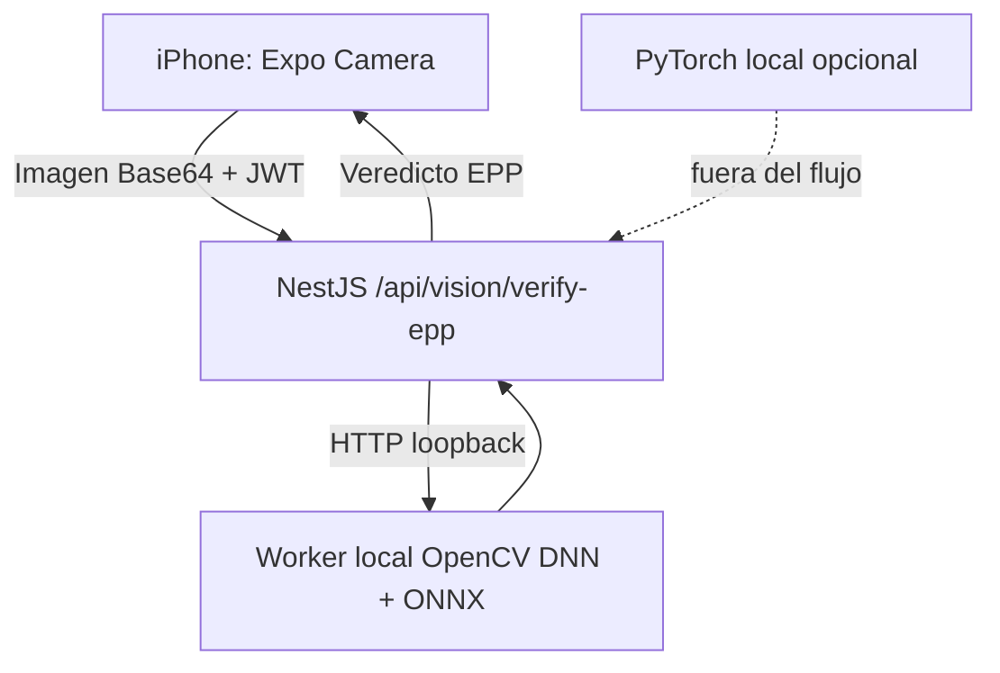

# Módulo de Seguridad Industrial 4.0

## Visión General

Este módulo incorpora un checkpoint móvil de Equipo de Protección Personal (EPP) al flujo de PlastControl. La app Expo captura una imagen, el backend NestJS la envía a un worker local con OpenCV DNN y un modelo ONNX, y devuelve el resultado de casco, lentes y chaleco.

La inferencia ocurre en la laptop: no requiere Roboflow, API key externa ni PyTorch. `security_monitor.py` queda como prototipo alternativo y no forma parte del flujo móvil. El checkpoint no controla una inyectora ni registra incidentes en PostgreSQL.

**Estado del modelo actual:** el ONNX INT8 publicado que se probó devuelve puntuaciones `0.0` en sus clases sobre imágenes de trabajadores, por lo que no se considera apto para identificar EPP. El backend trata esos casos como indeterminados y pide recapturar; no afirma cumplimiento ni faltantes sin detección explícita. Se requiere sustituir el artefacto por una exportación FP32/ONNX validada antes de confiar en sus predicciones.

### Auditoría de los datasets

El dataset nuevo `models/{train,valid,test}` tiene 23,648 imágenes de entrenamiento, 2,948 de validación y 2,975 de prueba; todos los pares imagen/etiqueta están completos. Sus 17 clases incluyen `helmet/no_helmet`, `goggles/no_goggles`, guantes y botas presentes/ausentes, pero **no incluye `Person` ni `no_vest`**; `no_ear_protection` tiene cero instancias. Por tanto, puede entrenar un verificador de PPE por imagen, no asociar cada elemento a una persona ni certificar ausencia de chaleco. El `data.yaml` no documenta licencia: confirma derechos y consentimiento de las personas antes de subir imágenes a Kaggle o redistribuirlas.

La carpeta anterior `Dataset_no_person_glasses` es otro dataset de cinco clases (8,243 train / 2,357 val / 1,177 test), con licencia CC BY-SA 4.0. Su autor retiró `Person` y `glasses`; no se debe mezclar sin recuperar/corregir esas anotaciones, porque los objetos ignorados podrían quedar como fondo.

La notebook existente `ai-safe-ppe-detection-with-yolov8.ipynb` entrenó un tercer dataset (`ppe-detection-v1`) de seis clases (`boots`, `gloves`, `goggles`, `helmet`, `person`, `vest`) y reportó mAP50 0.508, precisión 0.511 y recall 0.586. No es “100%” ni una autorización de seguridad. Se añadieron celdas v3 para entrenar/evaluar el dataset nuevo en Kaggle y exportar un ONNX FP32; esas celdas todavía deben ejecutarse en Kaggle.

---

## Objetivos del módulo

1. Capturar una fotografía del operario desde Expo Camera.
2. Evaluar casco, lentes y chaleco mediante el worker local OpenCV/ONNX.
3. Mostrar el veredicto y los elementos faltantes en la app móvil.
4. Mantener el procesamiento de imagen en la laptop, sin enviar fotos a un proveedor de inferencia externo.
5. Dejar preparado el punto de integración para auditoría, alertas y control físico en una fase posterior.

---

## Arquitectura funcional



---

## Regla de negocio

El sistema aplica la siguiente lógica:

El backend aplica una decisión conservadora por imagen:

- SEGURO solo cuando hay detección positiva suficiente de cada EPP requerido y el resultado es concluyente.
- INSEGURO solo cuando el modelo emite una clase explícita de ausencia (`NO-*`) con confianza suficiente.
- NO VERIFICABLE cuando no hay detección de persona, el modelo no soporta una clase requerida o no hay evidencia positiva/negativa suficiente.

El dataset actualmente agregado no incluye clases `NO-*`, persona ni gafas; por ello no puede producir por sí solo un veredicto completo de cumplimiento. No se debe convertir una ausencia de detección en “EPP faltante”.

### Cobertura del modelo

El antiguo prototipo usaba la clase COCO 67 (celular) como simulación de EPP; esa clase no representa equipo de protección y no se usa para el checkpoint actual. El modelo entrenado debe detectar las clases reales requeridas y las clases explícitas de incumplimiento, con validación en condiciones de planta.

---

## Stack tecnológico

- Inferencia EPP local: ONNX Runtime CPU + OpenCV para pre/postprocesado

### Base de datos utilizada

Este módulo usa la misma base de datos relacional del backend de PlastControl, es decir, PostgreSQL, siguiendo la arquitectura ya implementada por el proyecto.

---

## Requisitos previos

1. Tener el backend NestJS de PlastControl corriendo y accesible.
2. Instalar OpenCV y NumPy en Python, y descargar el modelo ONNX siguiendo la sección de ejecución local.
3. Conectar iPhone y laptop a la misma Wi-Fi para desarrollo local.
4. Instalar Expo Go y concederle permiso de cámara en iOS.
5. Configurar `EXPO_PUBLIC_API_URL` con la IPv4 local de la laptop.

---

## Dependencias

Ejecuta la instalación desde `ContaPlastico/security-module` en PowerShell:

```bash
Set-Location .\security-module
py -3.14 -m venv .venv
.\.venv\Scripts\python.exe -m pip install -r requirements.txt
```

La instalación principal solo incluye OpenCV, NumPy y ONNX Runtime; no instala PyTorch. El prototipo Python anterior que importa Ultralytics/Arduino es opcional y usa `requirements-local-yolo.txt`; en este equipo su ejecución puede seguir bloqueada por Control de aplicaciones.

---

## Configuración del entorno

### Variables sugeridas

```bash
DROIDCAM_URL=http://192.168.0.34:4747/video
YOLO_MODEL=yolov8n.pt
ARDUINO_PORT=COM3
ARDUINO_BAUD=9600
ENABLE_ARDUINO=false
ENABLE_DATABASE=false
```

Desde la raíz del repositorio, crea el archivo local con `Copy-Item .\security-module\.env.example .\security-module\.env`. El script lee `DATABASE_URL` desde `backend/.env` cuando `ENABLE_DATABASE=true`; también admite una URL privada en `security-module/.env`. No copies contraseñas reales a documentación. Las variables definidas en el proceso tienen prioridad.

---

## Estructura del módulo

```text
security-module/
├── README.md
├── security_monitor.py
├── schema.sql
├── arduino_firmware.ino
├── requirements.txt
└── .env.example
```

---

## Componentes del módulo

### Flujo móvil recomendado

1. Descarga `models/best.onnx` desde la notebook Kaggle usando los pasos de la sección siguiente.
2. Inicia `python .\local_inference.py` desde `security-module`; el worker escucha solo en `127.0.0.1:8010`.
3. Inicia el backend en el puerto `3000`.
4. Copia `mobile-app/.env.example` a `mobile-app/.env` y configura la IPv4 local de la laptop.
5. Inicia Expo con `npx expo start --go --host lan` y abre el proyecto desde Expo Go.
6. Inicia sesión, abre **Checkpoint EPP (IA)** y concede el permiso de cámara.

Las imágenes permanecen en la laptop: móvil -> NestJS -> worker local. No se requiere cuenta ni API key de Roboflow.

### 1. Script principal de detección

El archivo [security_monitor.py](security_monitor.py) es un prototipo local opcional. No forma parte del flujo móvil recomendado y requiere un entorno autorizado que cargue PyTorch. Se encarga de:

- abrir la cámara IP,
- capturar frames en tiempo real,
- ejecutar YOLOv8 sobre cada frame,
- evaluar la presencia de persona y EPP,
- cambiar el estado visual de la interfaz,
- enviar señales seriales solo cuando hay cambio de estado,
- guardar los cambios de estado en PostgreSQL cuando `ENABLE_DATABASE=true`.

### 2. Control de hardware

El Arduino recibe dos comandos seriales:

- `B` = Bloquear la máquina
- `L` = Liberar la máquina

El control de Arduino está desactivado de forma predeterminada. Solo se habilita con `ENABLE_ARDUINO=true`; cuando está habilitado, el monitor envía comandos al cambiar de estado y conserva el último comando confirmado para no repetir escrituras por frame.

### 3. Registro persistente

El checkpoint EPP actual devuelve el resultado al móvil, pero todavía no registra incidentes en PostgreSQL ni envía órdenes al Arduino. Esas capacidades requieren integración backend explícita y pruebas de seguridad antes de conectarse a maquinaria.

---

## Lógica de detección

### Estados del sistema

| Estado | Descripción | Acción |
| :--- | :--- | :--- |
| SEGURO | Persona y todos los EPP requeridos detectados de forma concluyente | Sin control físico habilitado |
| INSEGURO | El modelo detecta explícitamente una clase de ausencia de EPP | Sin control físico habilitado |
| NO VERIFICABLE | Persona/EPP no detectados con suficiente evidencia o clase no soportada | Solicitar nueva captura; no inferir ausencia |

### Clases del dataset agregado

`Helmet`, `Mask`, `Safety Vest`, `boots`, `glove`. El dataset no incluye `Person`, `glasses/goggles` ni etiquetas `NO-*`; consulta la auditoría anterior antes de entrenar o habilitar decisiones.

---

## Esquema de base de datos

El esquema recomendado para PostgreSQL es el siguiente:

Aplica el script [schema.sql](schema.sql) una sola vez sobre la misma base de datos PostgreSQL indicada por `DATABASE_URL` en `backend/.env`. El script crea la tabla e índices si no existen y no inserta datos de demostración.

```sql
CREATE TABLE IF NOT EXISTS security_incidents (
    id SERIAL PRIMARY KEY,
    detected_at TIMESTAMPTZ NOT NULL DEFAULT NOW(),
    camera_source VARCHAR(255) NOT NULL,
    status VARCHAR(20) NOT NULL CHECK (status IN ('SEGURO', 'INSEGURO', 'SIN_PERSONA')),
    person_detected BOOLEAN NOT NULL DEFAULT FALSE,
    equipment_detected BOOLEAN NOT NULL DEFAULT FALSE,
    block_signal CHAR(1) CHECK (block_signal IS NULL OR block_signal IN ('B', 'L')),
    notes TEXT,
    created_at TIMESTAMPTZ NOT NULL DEFAULT NOW()
);
```

Este modelo permite auditar cada evento y conectarlo con la solución web y móvil de PlastControl sin romper la infraestructura ya existente del backend.

---

## Integración con PlastControl

El flujo implementado está disponible en `POST /api/vision/verify-epp`, protegido con JWT y roles del sistema. La app móvil envía `imageBase64`; NestJS lo reenvía al worker local OpenCV/ONNX y devuelve los elementos detectados y faltantes. El endpoint no crea incidentes en PostgreSQL ni comunica resultados al Arduino.

Flujo actual:

```text
Expo Camera -> API NestJS (JWT) -> worker ONNX en loopback -> resultado EPP en la app
```

---

## Ejecución local sin Roboflow

La notebook ya exportó el checkpoint que necesitamos en `/kaggle/working/yolov8n-ppe-v2/weights/best.onnx`; `kaggle kernels pull` descarga el `.ipynb`, no sus archivos de salida. Para descargar el modelo desde Kaggle, abre la notebook ejecutada, agrega y ejecuta esta celda al final y pulsa el enlace que aparece:

```python
from IPython.display import FileLink, display

display(FileLink('/kaggle/working/yolov8n-ppe-v2/weights/best.onnx'))
```

Guarda el archivo descargado como `security-module/models/best.onnx`. No subas pesos ni credenciales a Git.

Instala el runtime de inferencia sin PyTorch desde la carpeta `security-module`:

```powershell
Set-Location .\security-module
py -3.14 -m venv .venv
.\.venv\Scripts\python.exe -m pip install -r requirements.txt
```

Terminal 1, worker local:

```powershell
Set-Location .\security-module
$env:PPE_ONNX_MODEL = ".\models\best.onnx"
$env:PPE_MODEL_CONFIG = ".\models\kaggle_ppe_config.json"
$env:PPE_CONFIDENCE_THRESHOLD = "0.25"
.\.venv\Scripts\python.exe .\local_inference.py
```

El worker usa ONNX Runtime CPU y escucha solo en `127.0.0.1:8010`; no importa PyTorch ni requiere una API key externa. Comprueba el modelo y las clases cargadas en `http://127.0.0.1:8010/health`.

Terminal 2, backend:

```powershell
Set-Location .\backend
npm.cmd run start:dev
```

Terminal 3, app móvil:

```powershell
Set-Location .\mobile-app
$env:EXPO_PUBLIC_API_URL = "http://<IPv4-DE-LA-LAPTOP>:3000"
npx expo start --go --host lan
```

El iPhone debe estar en la misma Wi-Fi y abrir el QR desde Expo Go. La ruta de imágenes es iPhone -> NestJS -> worker loopback; no se usa Roboflow.

## Ejecución del prototipo Python opcional

```bash
Set-Location .\security-module
python .\security_monitor.py
```

Este script requiere PyTorch local y no es necesario para usar el checkpoint de iPhone. En este equipo, Control de aplicaciones bloquea la DLL de PyTorch; usa el flujo Expo Go mientras no exista un entorno autorizado. Arduino y PostgreSQL permanecen apagados por defecto.

La interfaz mostrará el stream de la cámara con el estado visual en la parte superior:

- verde = seguro
- rojo = inseguro
- gris = sin persona

### Entorno Python y bloqueo de Windows

El equipo de desarrollo actual bloqueó `torch_cpu.dll` (WinError 4551). No es un error que el script pueda corregir y no se debe desactivar ni eludir la política. Solicita a TI un runtime administrado y autorización para los binarios de PyTorch verificados si se desea ejecutar el prototipo local.

Cuando el administrador entregue o apruebe Python 3.12, crea un entorno local sin elevación usando ese intérprete:

```powershell
Set-Location .\security-module
py -3.12 -m venv .venv
.\.venv\Scripts\python.exe -m pip install -r requirements.txt
.\.venv\Scripts\python.exe .\security_monitor.py
```

Si la organización no permite instalar desde PyPI, pide que el administrador prepare el entorno desde su repositorio interno aprobado. No copies DLLs a mano, no agregues exclusiones amplias y no ejecutes la instalación como administrador sin autorización.

#### Solicitud para el administrador

Comparte el error exacto `WinError 4551` y la ruta bloqueada que aparece en el traceback (`...Python314\site-packages\torch\lib\shm.dll`). Solicita una de estas opciones:

1. Un entorno Python administrado y compatible, con PyTorch/Ultralytics instalados desde la fuente corporativa aprobada.
2. La aprobación de los binarios legítimos y sus dependencias mediante la política central de Control de aplicaciones de la organización, una vez verificados su origen, firma e integridad.

El administrador debe aplicar cualquier cambio de política siguiendo el proceso corporativo. El usuario no necesita ni debe desactivar Control de aplicaciones.

#### Seguridad y limitaciones

- La clase COCO 67 es un celular y aquí solo simula EPP; no demuestra el uso real de casco, guantes u otro equipo.
- El EPP se detecta en toda la imagen y no se asocia a una persona específica; un celular ajeno puede producir un falso estado seguro.
- El Arduino está desactivado por defecto. No conectes esta simulación a una máquina real ni la uses como sistema de seguridad certificado.
- El monitor no tiene todavía una vista integrada en la app móvil ni en el dashboard web.

---

## Recomendaciones para producción

- Incorporar y validar clases `Person`, `goggles`, `NO-Hardhat`, `NO-Goggles` y ausencia de chaleco antes de habilitar un veredicto completo.
- Crear endpoint REST en NestJS para recibir eventos.
- Añadir panel visual en el dashboard de administración.
- Guardar logs de eventos y tiempos de respuesta del Arduino.
- Integrar notificaciones al área de seguridad en caso de incidentes repetidos.

---

## Conclusión

El módulo de Seguridad Industrial 4.0 complementa a PlastControl con una capa de supervisión visual y control automatizado, reforzando la seguridad laboral y la continuidad de la operación en la planta. Su diseño está alineado con la arquitectura actual del proyecto y usa la misma base de datos central del backend, asegurando coherencia técnica y escalabilidad futura.
